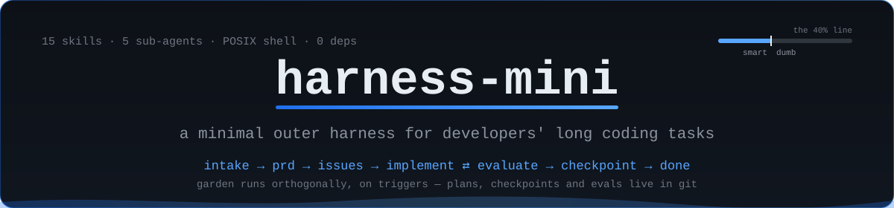

<p align="center">
  
</p>

# harness-mini

**A minimal outer harness for developers' long coding tasks.**

<p align="center">
  <a href="https://github.com/harness-mini/harness-mini/releases"></a>
  <a href="LICENSE"></a>
  <a href="CONTRIBUTING.md"></a>
  
</p>

Run a coding agent on a multi-session feature and three failure modes compound:
it **drifts** off the goal, **context explodes** as heavy reads crowd out working
memory, and closing the window means **session amnesia** — decisions and
in-flight plans evaporate. harness-mini keeps that work **on-task,
context-light, and resumable** with nothing but repo conventions and thin shell
glue: skills, sub-agents, plans, checkpoints, and evals — all committed to git.
It is an **outer harness around your coding agent** (not a generic agent shell,
not a sandbox platform), and its whole contract is **files + shell**: any agent
that can read the repo and run commands can drive it.

## Core Architecture Contract

The harness is an **environment, not a program** — no runtime, no daemon, no
package manager, no third-party binary. Five invariants define it:

| Invariant | Meaning | System of record |
|---|---|---|
| **1 · Files + shell** | Markdown skills + small POSIX `bin/*.sh`; nothing else executes. | [`ARCHITECTURE.md`](ARCHITECTURE.md) |
| **2 · Lifecycle FSM** | Every requirement rides `intake → prd → issues → implement ⇄ evaluate → checkpoint → done`; only the main agent (via `stage-viewer`) advances a stage. | [`ARCHITECTURE.md`](ARCHITECTURE.md#lifecycle-fsm) |
| **3 · Anti-self-praise firewall** | `done` requires an independent `verdict: pass` committed to `.trace/evals/` — `harness.sh doctor` FAILs otherwise. | the [`evaluate`](skills/evaluate/SKILL.md) skill |
| **4 · The 40% line** | Keep context occupancy below 40%; delegate heavy reads to disposable `explorer` sub-agents (context firewalls); checkpoint + reset at the line. | [`docs/smart-dumb.md`](docs/smart-dumb.md) |
| **5 · Managed-set boundary** | The harness tracks runtime files and project files in separate locks; your exec-plans, `.trace/`, and project code are never touched by `update`. | [`ARCHITECTURE.md`](ARCHITECTURE.md#versioning--update-model) |

Under all of it sits the **Mini constraint** — delete before you add; a new
capability is a doc by default and only becomes shell when it must execute
([`docs/principles.md`](docs/principles.md)).

## Who it's for / not for

| For | Not for |
|---|---|
| Developers doing cross-session feature work who will commit plans & traces | One-shot Q&A, chat-only agents, or anyone who won't write plans to git |
| Bootstrap → one feature at a time → independent eval → mergeable main | Generic non-coding long-running orchestration as the primary story |
| Outer harness (guides + sensors) around your coding agent | IDE replacement, multi-agent SaaS, or "sandbox as the product" |

## How it compares (one glance)

| | harness-mini | Generic agent harness | Bare coding agent | Host CI only |
|---|---|---|---|---|
| Focus | **Coding** long tasks | Often domain-general | Single-session by default | Gates after the fact |
| Cross-session bridge | Plans, checkpoints, evals in-repo | Varies / platform state | You reinvent it | No agent loop |
| Done gate | Independent evaluate + `doctor` | Often self-report | Easy to self-praise | Pass/fail without agent education |

## Quick Demo

<!-- TODO: replace with asciicast recording -->

> _Placeholder for an asciicast recording._ The clip should show, end-to-end:
> `init.sh` grafting the harness into a project, the agent routing a real task
> through `stage-viewer` (intake → prd → issues → implement), a disposable
> `explorer` absorbing a heavy read so the main context stays under the 40% line,
> an `evaluator` grading the slice in a separate window, and a committed
> checkpoint that a brand-new session resumes from with zero context loss.

## Install

It installs like a skill — tell your agent *"install harness-mini here"*, or run:

```bash
git clone https://github.com/harness-mini/harness-mini.git
bash harness-mini/init.sh /path/to/your/project
```

`init.sh` is **additive** (never overwrites your files) and **idempotent** (safe
to re-run). It behaves asymmetrically:

- **New/empty project** → generative bootstrap: seeds an intake plan and runs the
  founder funnel (`founder-check → to-prd → to-issues`).
- **Existing project** → recon graft: installs additively and seeds a recon plan
  (the `explorer` maps your codebase into `ARCHITECTURE.md`); skips the founder
  funnel.

Every agent uses the same project layout: skills and nested resources go under
`.agents/skills/`, role descriptions go under `harness/agents/`, and shared
instructions live in `AGENTS.md`. `harness/manifest.md` lists the installed
skills. The installer does not detect the current agent or generate host-specific
skill mirrors or routing files.

The runtime executables are installed once under `~/.harness-mini/bin/`; a
project does not need its own `bin/` directory. From a project root, run the
shared status command and follow its `path:` line:

```bash
"$HOME/.harness-mini/bin/harness.sh" status
```

Open `session-init` for planning work or `session-coding` for implementation.
Non-trivial work routes through `stage-viewer`, and when a harness skill and
another tool both fit, the harness skill wins. See [The session path](#the-session-path).

## Your first task: quick or full?

harness-mini does **not** force ceremony onto every change. Route first:

| If the task is… | Use | Path |
|---|---|---|
| a small bug fix · one obvious change · no ambiguity (≤ ~1 slice) | **Quick mode** | copy [`docs/templates/quick-plan.md`](docs/templates/quick-plan.md) → implement (`tdd`) → L0/L1 eval → checkpoint |
| ambiguous · cross-cutting · architecture/security/data-loss impact | **Full mode** | copy [`docs/templates/full-plan.md`](docs/templates/full-plan.md) → PRD → issues → implement → L1/L2 evaluate → checkpoint |

The `stage-viewer` skill makes this call; the templates are its two shapes. **New
to the loop? Watch one run end-to-end: [`docs/walkthrough.md`](docs/walkthrough.md).**

## The session path

Every session starts from **file truth**, not memory. The shared runtime command
distills the board into machine lines:

```console
$ "$HOME/.harness-mini/bin/harness.sh" --root "$PWD" status
active plans:
  demo-auth                stage: implement
     workboard: in_progress · 1/3 pass · current: slice-002 · next: slice-002
path: coding
path_reason: next slice ready
ready: ready — slice-002: write the failing 401 test, then bcrypt verification
```

The `path:` line picks the playbook:

- **`path: init`** → the **`session-init`** skill: plan-layer work only
  (founder funnel, PRD, issues, the JSON twin) — **no product code** on this path.
- **`path: coding`** → the **`session-coding`** skill: a mandatory five-step
  **Getting Bearings** first turn (`pwd` · `status` + recent commits + latest
  checkpoint · open the twin and select the `next:` slice · app baseline green ·
  report the selected slice), then exactly **one slice**, test-first, verified
  against the twin's `steps` and routed through `evaluate` — the builder never
  flips `passes` (anti-self-praise).

Each plan is a **dual file**: `<NNN-slug>.md` (narrative; frontmatter `stage:`
is the lifecycle authority) + a same-basename `.json` twin (the machine
workboard: `status` · `current_slice_id` · `slices[].passes`). A
`## Session Context Handoff` section gives a cold session its three-line
memory. For unattended runs, `"$HOME/.harness-mini/bin/session.sh"` forces the matching playbook
into a fresh context (`"$HOME/.harness-mini/bin/session.sh" -- <agent-command> …`); it is optional
P2 glue, not part of the core.

## Versioning & updates

The install is versioned. The front door is `~/.harness-mini/bin/harness.sh`:

```bash
"$HOME/.harness-mini/bin/harness.sh" --root "$PWD" version              # installed version (+ latest, best-effort)
"$HOME/.harness-mini/bin/harness.sh" --root "$PWD" update               # update runtime and this project's shared files
"$HOME/.harness-mini/bin/harness.sh" --root "$PWD" doctor               # install health: ok/warn/fail (exit 1 on fail)
"$HOME/.harness-mini/bin/harness.sh" --root "$PWD" status               # work state: plans, workboard, session path, resumable
"$HOME/.harness-mini/bin/harness.sh" --root "$PWD" report               # aggregate .trace metrics (stages, context, evals)
"$HOME/.harness-mini/bin/harness.sh" --root "$PWD" release <x.y.z>      # (source repo) bump + tag + GitHub release
```

The firewall has **teeth**: a plan can't reach `done` without a committed
`verdict: pass` record in `.trace/evals/` — `doctor` FAILs otherwise. `report`
turns the runtime traces into a metrics summary (context trend vs the 40% line,
eval pass-rate + rework loops) so the thresholds are tuned by data, not vibes.
Agents that support a PostToolUse hook can give the 40% rule teeth with the
optional `~/.harness-mini/bin/ctx-hook.sh` (see `docs/smart-dumb.md`). Configure
that hook in the agent's own settings if desired.

On entering a fresh session the agent runs the shared runtime's `harness.sh status` first (the
routing gate is status-first); when a newer release exists, `version`, `status`,
and `doctor` all surface an **update reminder**, so you're prompted to `update`
rather than drifting behind. The check is best-effort and silent offline
(`HARNESS_NO_NET`); `HARNESS_LATEST` pins it.

`init.sh` records project-managed files in `harness/harness.lock` and executable
runtime files in `~/.harness-mini/harness/runtime.lock`. `update` is
**checksum-guarded**: files you never touched are refreshed silently, files
**you edited are kept** (the upstream copy is written next to them as
`<file>.new`), and brand-new files are added. Project plans, `.trace/`, and
project code are never touched. `release` stamps
`VERSION`, rolls `CHANGELOG.md`, tags `v<x.y.z>`, and cuts a GitHub release,
gated on green tests + a clean tree (see the `release` skill).

## The one rule: the 40% line

Context occupancy **below 40% = smart zone**; **at/above 40% = dumb zone**. Every
agent keeps itself smart by (1) delegating heavy reads to a disposable `explorer`
(context firewall), (2) checkpointing + resetting at 40%, (3) progressive
disclosure. See `docs/smart-dumb.md`. Estimate with
`"$HOME/.harness-mini/bin/ctx.sh" <used> [window]`.

> **What we measured** ([`bench/cib/results/FINDINGS.md`](bench/cib/results/FINDINGS.md)).
> We built a benchmark (`bench/cib/`) and ran it live on gpt-4o-mini, haiku-4.5, and
> Qwen2.5-7B. Under a controlled design (fixed task, only context fill varied), **raw
> occupancy showed no 40% "intelligence cliff"** — even on the small model from the paper
> that motivated the line. What degraded real QA-F1 was **interference** (competing,
> related content), not how *full* the window was. So **40% is a conservative checkpoint
> default, not a law** — and the firewall + progressive-disclosure mechanisms earn their
> keep by holding *competing content out*, which is the effect that actually matters.
> (Caveat: gradual/modest effect, frontier-model contrast still pending.)

## Lifecycle

```
intake → prd → issues → implement ⇄ evaluate → checkpoint → done
                           ↑___________|   (loop until criteria pass)
       garden ──── runs orthogonally, on triggers ────
```

Only the main agent advances the stage (via `stage-viewer`). No worker promotes
its own work to "done" — evaluation happens in a **separate context** (the
anti-self-praise gate), **tiered by risk**: L0 self-check · **L1 lightweight
reviewer (default)** · L2 full Opus evaluator. See the `evaluate` skill.

## Layout

| Path | Purpose |
|------|---------|
| `AGENTS.md` | context navigation map injected every run (anchor marks) |
| `ARCHITECTURE.md` | layer stack + lifecycle FSM |
| `init.sh` | additive/idempotent installer |
| `VERSION` · `CHANGELOG.md` | canonical version (SemVer) · release log |
| `bin/*.sh` | runtime script sources; installed under `~/.harness-mini/bin/` |
| `~/.harness-mini/harness/runtime.lock` | runtime version + executable checksums |
| `harness/harness.lock` | project version + project-managed file checksums |
| `skills/<name>/SKILL.md` → `.agents/skills/` | shared skill directory, installed recursively |
| `skills/checkpoint/scripts/` → `.agents/skills/checkpoint/scripts/` | checkpoint-only Footprint validator, line snapshotter, and no-op guard |
| `agents/` → `harness/agents/` | role descriptions for agent workflows |
| `docs/principles.md` | golden principles + the Mini delete-first constraint |
| `docs/smart-dumb.md` | the 40% contract |
| `docs/exec-plans/{active,completed}/` | dual-file plans (`.md` narrative + `.json` workboard twin) + decision logs (committed) |
| `docs/references/*-llms.txt` | the 5 source distillates |
| `.trace/checkpoints/` | committed handoffs (institutional memory) |
| `.trace/evals/` | committed evaluation verdicts (the `done`-gate `doctor` enforces) |
| `.trace/runtime/` | gitignored ephemeral JSONL traces (`harness.sh report` reads these) |
| `tests/run.sh` | zero-dep TDD suite |
| `bench/cib/` | context-intelligence benchmark + live results ([`FINDINGS.md`](bench/cib/results/FINDINGS.md)) |

> **Editing skills?** `skills/<name>/SKILL.md` (and `agents/<name>.md`) are the
> **canonical source** — edit there. `init.sh` copies skills into a target
> project's `.agents/skills/` and roles into `harness/agents/`.

## Sub-agents

| Agent | Role | Model |
|-------|------|-------|
| planner | goal → exec-plan + issues | sonnet |
| generator | build one slice via TDD | sonnet · **opus** when enabled |
| evaluator | grade vs criteria (separate window) | opus |
| explorer | disposable read/search → distillate | haiku |
| gardener | entropy GC / doc-gardening | haiku |

Model is a capability **tier**, not a pinned version. The **builder** (generator)
auto-upgrades to **the highest-available frontier model tier** (`opus`, the top
tier the harness names) when `HARNESS_TOP_MODEL` is set, falling back to sonnet
otherwise; every other role keeps its static tier. The spawning agent resolves it
at spawn time via `"$HOME/.harness-mini/bin/model.sh" builder` and passes the result as the worker's
model override. Set `HARNESS_TOP_MODEL=1` to force the upgrade;
`HARNESS_MODEL_BUILDER=<alias>` pins the builder to an exact model.

## Develop

```bash
bash tests/run.sh   # 299 assertions, zero dependencies
```

Pure POSIX shell, no dependencies — tested on macOS `bash` 3.2 and Linux `bash`,
and safe to call from `zsh`. See the compatibility notes in
[`CONTRIBUTING.md`](CONTRIBUTING.md) before contributing shell.

## References distilled in `docs/references/`
- Anthropic — Effective harnesses for long-running agents
- Anthropic — Harness design for long-running apps
- Anthropic — Scaling managed agents (decoupling brain/hands/session; stale assumptions)
- OpenAI — Harness engineering (leveraging Codex)
- Anthropic — The Founder's Playbook

## Contributing

Issues and PRs welcome — see [`CONTRIBUTING.md`](CONTRIBUTING.md). It's a small,
opinionated harness: most contributions are Markdown (skills, agents, docs) plus
the occasional ~30 lines of test-first shell. Ship thin, keep it smart.

## Community

[GitHub Discussions](https://github.com/harness-mini/harness-mini/discussions) —
questions, show-and-tell, and feedback welcome.

Accessibility matters here too — our [accessibility statement](ACCESSIBILITY.md)
covers goals for the CLI's plain-text output and the docs, supported
environments, and how to report barriers.

## License

[MIT](LICENSE) © 2026 harness-mini contributors.
